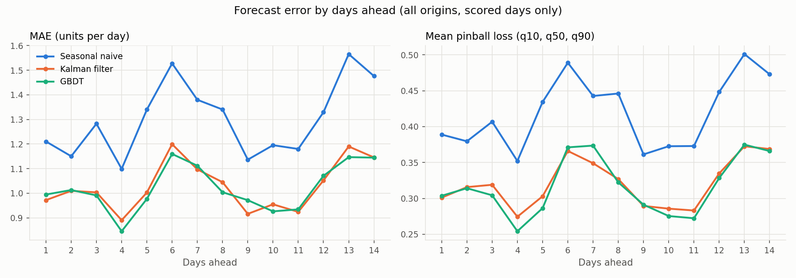
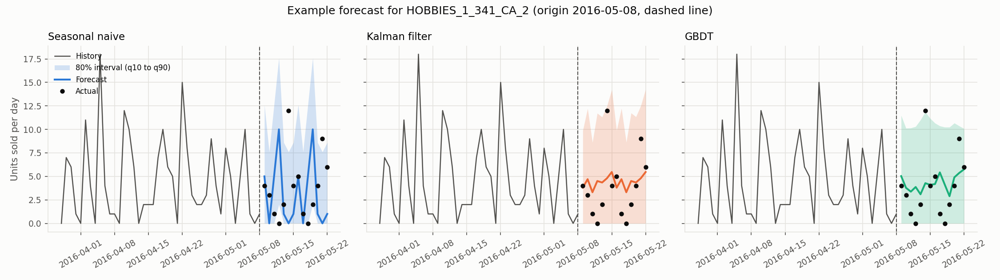
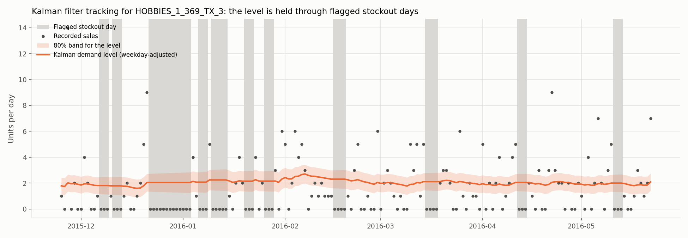

# Phase 1 Report: Inventory Demand Forecasting on M5

Local state tracking (Kalman filter) vs. tabular AML baselines (seasonal naive, GBDT),
compared with a rolling-origin backtest. Phase 2 will add a global DeepAR / LSTM model to
the same backtest.

## 1. Data

- Source: M5 Forecasting - Accuracy (Walmart daily unit sales), files `sales_train_evaluation.csv`, `calendar.csv`, `sell_prices.csv`.
- Sample: **99 series** (item x store) from all 3 categories and 10 stores:
  75 established items and 24 items launched during the window (cold start).
- Period: 2014-10-01 to 2016-05-22 (600 days), one row per series per day (complete date grid).
- **Launch date** = the first day an item ever sold. Days before launch are not used for training or scoring.
- **Stockouts are marked, not imputed.** A run of zero-sales days is flagged when it is too long to be bad luck:
  if an item sells `rate` units a day, k zero days in a row happen by chance with probability about exp(-rate x k);
  runs where this is below 1% (and at least 3 days) are flagged.
  19.5% of active days are flagged. Sales numbers are never changed.
- **Cold start** = a series launched less than 90 days before the forecast origin.

## 2. Models

| Model | Idea | Uncertainty |
|---|---|---|
| Seasonal naive | repeat the same weekday from last week | quantiles of its own past weekly errors |
| Kalman filter (one per series) | local demand level that moves slowly + weekday effects; skips the update on stockout days | Gaussian forecast variance P + h*q + r |
| GBDT (one global model) | gradient boosted trees on lags, rolling means, calendar, SNAP, events, price, item/store codes | separate quantile-loss models for q10, q50, q90 |

Kalman filter settings (q/r and r) and weekday effects are estimated **separately for every series** from its own training data.
The GBDT learns only from in-stock days, and its lag features treat stockout days as missing.

## 3. Backtest setup (identical for every model)

- 6 forecast origins, every 14 days: 2016-02-28, 2016-03-13, 2016-03-27, 2016-04-10, 2016-04-24, 2016-05-08.
- Horizon: 14 days after each origin. Quantiles: 0.1, 0.5, 0.9.
- Models only see data up to the origin. Stockout flags for training are re-computed from data up to the origin.
- A series is forecast only if it has at least 7 days of history at the origin.
- **Scored days:** days after launch that are not stockouts (7293 series-days per model).
- The exact series list and origins are saved in `reports/backtest_setup.json` so Phase 2 uses the same split.

## 4. Results

### Overall (scored days, all origins pooled)

| model | MAE | RMSE | WAPE | pinball_q10 | pinball_q50 | pinball_q90 | mean_pinball | coverage |
|---|---|---|---|---|---|---|---|---|
| Seasonal naive | 1.302 | 2.568 | 0.921 | 0.250 | 0.652 | 0.357 | 0.420 | 0.836 |
| Kalman filter | 1.029 | 1.865 | 0.728 | 0.135 | 0.515 | 0.313 | 0.321 | 0.878 |
| GBDT | 1.022 | 1.841 | 0.723 | 0.137 | 0.515 | 0.300 | 0.317 | 0.900 |

WAPE = total absolute error / total sales. Coverage = share of actual sales inside the q10 to q90 interval (target 80%).

### WAPE per origin

| fold | origin | Seasonal naive | Kalman filter | GBDT |
|---|---|---|---|---|
| 1 | 2016-02-28 | 0.881 | 0.687 | 0.703 |
| 2 | 2016-03-13 | 1.003 | 0.781 | 0.758 |
| 3 | 2016-03-27 | 0.902 | 0.752 | 0.736 |
| 4 | 2016-04-10 | 0.970 | 0.749 | 0.722 |
| 5 | 2016-04-24 | 0.930 | 0.743 | 0.750 |
| 6 | 2016-05-08 | 0.857 | 0.668 | 0.674 |

### MAE by days ahead

| step | Seasonal naive | Kalman filter | GBDT |
|---|---|---|---|
| 1 | 1.210 | 0.972 | 0.995 |
| 7 | 1.380 | 1.097 | 1.112 |
| 14 | 1.476 | 1.146 | 1.145 |

### Cold start vs. established series

| segment | model | rows | MAE | WAPE | mean_pinball | coverage |
|---|---|---|---|---|---|---|
| cold start | Seasonal naive | 1341 | 1.156 | 1.037 | 0.374 | 0.818 |
| established | Seasonal naive | 5952 | 1.335 | 0.901 | 0.430 | 0.840 |
| cold start | Kalman filter | 1341 | 0.929 | 0.834 | 0.295 | 0.840 |
| established | Kalman filter | 5952 | 1.052 | 0.710 | 0.327 | 0.886 |
| cold start | GBDT | 1341 | 0.915 | 0.821 | 0.297 | 0.883 |
| established | GBDT | 5952 | 1.046 | 0.706 | 0.322 | 0.904 |

### What changes if stockout zeros are scored as real demand

| model | rows | MAE | RMSE | WAPE | mean_pinball |
|---|---|---|---|---|---|
| Seasonal naive | 8316 | 1.192 | 2.445 | 0.961 | 0.386 |
| Kalman filter | 8316 | 0.991 | 1.798 | 0.799 | 0.306 |
| GBDT | 8316 | 0.986 | 1.762 | 0.795 | 0.295 |

### Example forecast

### Kalman filter and stockouts

## 5. Findings

- **Best point accuracy:** GBDT has the lowest WAPE (0.723).
- Kalman filter lowers WAPE by 20.9% compared with seasonal naive.
- GBDT lowers WAPE by 21.5% compared with seasonal naive.
- The Kalman filter and GBDT are 0.8% apart on WAPE, so a simple local filter is almost as accurate as the global tree model on these series.
- **Best uncertainty (pinball loss):** GBDT (0.317).
- **Interval coverage** (target 80%): Seasonal naive 84%, Kalman filter 88%, GBDT 90%. Part of the extra coverage comes from zero-sales days, which land exactly on a q10 of 0.
- Kalman filter MAE goes from 0.972 at day 1 to 1.146 at day 14.
- GBDT MAE goes from 0.995 at day 1 to 1.145 at day 14.
- The error curves zig-zag because every origin is a Sunday, so each 'days ahead' value is always the same weekday (weekends sell more and have bigger errors).
- **Cold start:** GBDT WAPE is 0.821 on cold-start series vs 0.706 on established ones. Best cold-start pinball loss: Kalman filter.
- **Stockouts:** scoring the stockout zeros as if they were real demand would raise WAPE (Seasonal naive 0.921 -> 0.961, Kalman filter 0.728 -> 0.799, GBDT 0.723 -> 0.795), because forecasts of demand that was lost to an empty shelf would count as errors. On stockout days the models forecast on average Seasonal naive 0.40, Kalman filter 0.72, GBDT 0.73 units per day.

## 6. The gap that Phase 2 addresses

- The Kalman filter learns each series on its own. A new item starts with no weekday pattern and a rough level,
  and nothing it learns about one item helps another.
- The GBDT is global, but it only sees hand-made lag features, needs a recursive loop for multi-day forecasts,
  and its quantiles come from three separate models rather than one predictive distribution.
- Phase 2 trains a **global DeepAR / LSTM** with static item/store identifiers and calendar/price features, using a
  count likelihood (negative binomial). It will be scored on the same series, origins, horizon, scored days and metrics,
  by adding its rows to `reports/predictions.csv`.

## 7. Limitations

- 99 series is a small sample of the 30,490 in M5. Differences of a few percent between models may not hold on the full data.
- Stockouts are inferred from sales only; M5 has no inventory data, so some flagged runs may be real zero demand.
- Gaussian Kalman intervals are not ideal for small whole-number sales.
